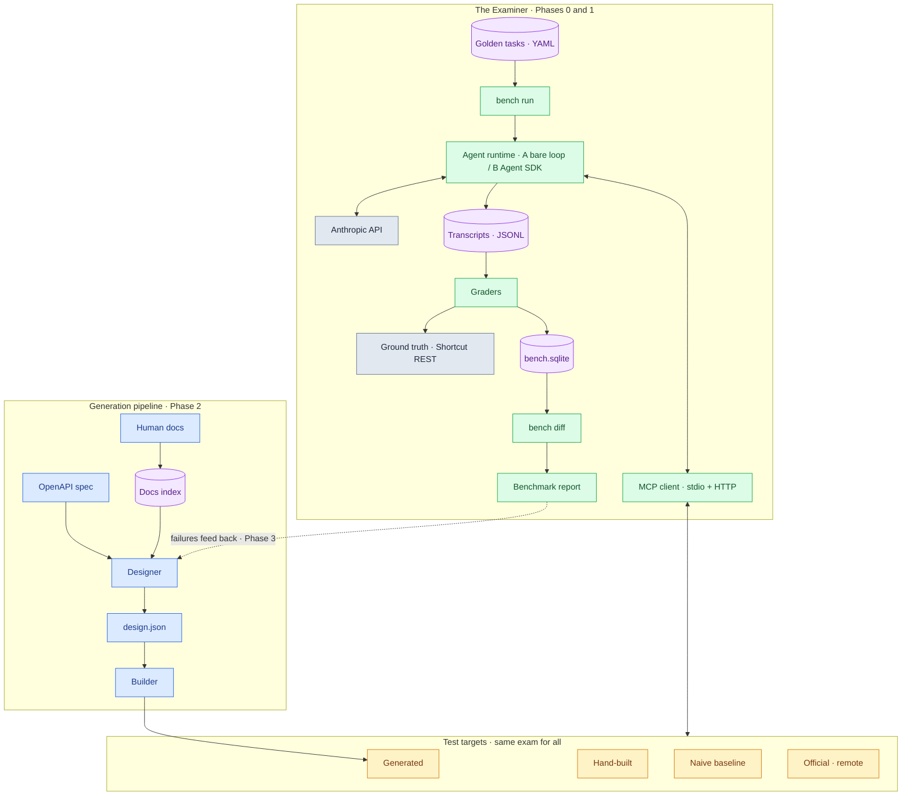

# STACK.md — Technical Stack & Architecture

Companion to `PROJECT.md`. That file explains the project to anyone; this one is for the builder.

**Philosophy:** boring core, zero infrastructure, everything is a file, local-first. The only servers in this project are the ones being tested.

---

## Architecture at a glance

Color legend: **blue** = generation pipeline, **amber** = test targets, **green** = the Examiner, **purple** = data stores, **gray** = external services. Solid arrows are Phases 0 to 2; the dashed arrow is the Phase 3 improvement loop.



## The diagram in plain words

One machine, three rooms. The easiest way to hold it: a driving test where
the driver is never the one being judged. Same driver, four different cars,
same fixed course. The better car is the one that lets the driver finish
the course best.

**The green room is the exam (built first, Phases 0 and 1).** The course is
the golden tasks: short real chores in plain files, each with a checkable
definition of done ("a story named X now exists in the backlog").
`bench run` starts a test day. The driver is the AI agent; its seat comes
in two versions (Runtime A, the bare loop; Runtime B, the Agent SDK,
useful for checking whether the seat itself changes results). The driver's
brain is the model at Anthropic; every decision is an API call, which is
why that box is gray: an outside service. The MCP client is the cable
between driver and car, with two plug shapes: stdio for cars in our own
garage (local servers) and HTTP for the manufacturer's car that stays at
their building (the official remote server). A dashcam records everything:
the transcripts. Then the inspectors, the graders, apply their one rule:
never take the driver's word for anything. They check Shortcut's own
records (ground truth) to confirm the chore truly happened. Every
attempt's pass/fail, time, and cost lands in the scorebook (SQLite).
`bench diff` puts two scorebook pages side by side; the benchmark report
is the published scorecard.

**The amber row is the four cars.** Naive: auto-assembled by bolting on
every part in the catalog, 400 unlabeled buttons. Hand-built: crafted by
a person, twelve clear controls. Official: the car the vendor's own
engineers ship. Generated: the car our factory produces. All four take
the identical exam; change one thing only, the car, keep everything else
fixed.

**The blue room is the factory (Phase 2).** It reads two books, the
engineering manual (the API spec) and the human handbook (the docs), with
a small filing index so the Designer can pull the right pages fast. The
Designer draws a blueprint (`design.json`), plain data a human can read.
The Builder assembles the car from the blueprint using fixed templates.
The AI designs; the templates build.

**The dashed arrow is Phase 3, the loop.** Failure notes from each test
day travel back to the blueprint desk: wrong button pressed, confusing
label, missing control. The next blueprint gets better. That arrow is the
difference between a self-improving machine and a one-shot converter.

Reading keys: purple cylinders are filing cabinets, places where records
live; gray boxes are outside services. Build order runs opposite to the
arrows: exam room first, factory second, loop last, because the measuring
instrument comes before the factory. A factory nobody can grade is a
guess machine.

## Runtime & tooling

| Concern          | Choice                          | Why                                                        |
| ---------------- | ------------------------------- | ---------------------------------------------------------- |
| Runtime          | Node 22 LTS                     | Boring, supported everywhere                                |
| Language         | TypeScript, `strict: true`      | Decided; velocity stays on AI concepts, not syntax          |
| Package manager  | pnpm + workspaces               | One repo, packages emerge per phase                         |
| Dev execution    | tsx                             | Run TS directly, no build step in dev                       |
| Unit tests       | vitest                          | Tests OUR code (parsers, graders). The Examiner tests toolsets — different thing |
| Lint + format    | Biome                           | One tool, one config, fast                                  |

## Model providers

**Primary: Anthropic** (`@anthropic-ai/sdk`), API key from console.anthropic.com, pay-as-you-go.

Reasons, in order: (1) the existing Claude subscription includes a monthly Agent SDK credit for programmatic runs — free sweep budget already paid for; (2) prompt caching is the project's main cost lever; (3) benchmark credibility — MCP consumers today mostly run Claude-family agents, so results measured there persuade the most; (4) stack knowledge transfers directly to daily tooling.

**Secondary (Phase 3+): OpenAI** as a cross-model lane. Existing OpenAI credits get used here. Cross-model results make the final write-up stronger.

**Model tiers** (exact IDs pinned in config, recorded in `docs/decisions.md`):
- `smoke`: cheapest/fastest model — 30-second sanity sweeps before real runs
- `dev`: strong model for development iteration
- `official`: ONE pinned strong model — the only model whose numbers appear in reports

Tiers are pinned at first use: dev now, official at the Phase 1 gate, smoke when sweeps exist.

## Agent runtimes (pluggable)

Every runtime implements one interface so servers can be measured under different harnesses:

```ts
interface AgentRuntime {
  run(task: GoldenTask, server: McpTarget, opts: RunOpts): Promise<Transcript>;
}
```

- **Runtime A — bare loop** (Phase 0). Hand-built on the raw Anthropic SDK. Full control: model, temperature, token accounting. The learning artifact and the canonical instrument. Billing: API key.
- **Runtime B — Agent SDK** (optional lane). Authenticated via Claude subscription, draws from the monthly Agent SDK credit. Good for bulk dev sweeps; also measures harness effects (same server, different loop). Billing: subscription credit.
- **Runtime C — other providers** (Phase 3+). OpenAI first. Billing: their keys.

## MCP layer

- `@modelcontextprotocol/sdk` on both sides: client inside the harness, server base for hand-built and generated toolsets.
- Client transports: **stdio** (local servers under `servers/`) and **streamable HTTP** (the official Shortcut server is remote).
- Generated servers are standalone pnpm packages: installable, runnable, inspectable.

## Data layer — three tiers, right-sized

| Data              | Home                              | Why                                                       |
| ----------------- | --------------------------------- | ---------------------------------------------------------- |
| Golden tasks      | YAML files in git (`tasks/`)      | Tests deserve review and diffs; zod-validated on load       |
| Transcripts       | JSONL on disk (`runs/`)           | Big blobs stay out of databases                             |
| Metrics & results | SQLite (`runs/bench.sqlite`)      | The core query is "run A vs run B by task/server/model" — that's SQL. One file, zero services |

- SQLite via `better-sqlite3` + Drizzle ORM. The DB is **derived and disposable**: rebuildable from transcripts. Canonical data lives in files.
- Phase 2 adds `sqlite-vec` to the same file for docs retrieval (the RAG component).
- Embeddings: **decision deferred to Phase 2 gate.** Anthropic has no embeddings endpoint; candidates are Voyage or OpenAI. Cost is negligible either way.

## Pipelines

- **OpenAPI ingestion:** `@apidevtools/swagger-parser` (dereference), `openapi-types` for typing.
- **Designer output:** strict structured output validated by a zod `Design` schema → `design.json`. The design is data; humans and evals can both read it.
- **Builder (codegen):** template literals + Prettier on the output. No AST machinery — the design→code mapping is narrow and deterministic by design. The LLM designs; templates emit.

## Reliability & cost

- `p-limit` — concurrency capped against rate limits
- `p-retry` — exponential backoff on API hiccups
- `pino` — structured JSONL logs
- **Prompt caching** — system prompt + tool definitions repeat across every task × repetition; caching them is the single biggest cost reduction
- Token accounting from API `usage` fields → stored per attempt in SQLite

## Interface

`commander` CLI. Command surface:

```
bench run       # run a task suite against a server target
bench diff      # compare runs → markdown table
gen design      # spec + docs → design.json        (Phase 2)
gen build       # design.json → server package     (Phase 2)
tasks validate  # zod-check the golden task files
```

Reports are generated markdown committed under `docs/reports/`. **No dashboard before Phase 4.**

## Repo layout

```
agentworks/
  packages/
    agent/      # bare loop (Phase 0)
    harness/    # runner, graders, metrics (Phase 1)
    designer/   # spec + docs -> design.json (Phase 2)
    builder/    # design.json -> server code (Phase 2)
    cli/
  servers/      # hand-built / naive / generated
  tasks/        # golden tasks, YAML
  runs/         # transcripts (JSONL) + bench.sqlite   [gitignored except summaries]
  docs/         # PROJECT.md, STACK.md, decisions.md, reports/
```

## Secrets

`.env`, never committed. Expected keys: `ANTHROPIC_API_KEY`, `SHORTCUT_API_TOKEN` (personal workspace), later `VOYAGE_API_KEY` or `OPENAI_API_KEY`.

## Explicit exclusions

- **No LangChain / LangGraph / AI SDK** for the loop — the loop is the curriculum.
- **No Postgres, Redis, queues, Docker** — nothing here needs them; infra tax kills solo projects.
- **No eval SaaS** (Braintrust, LangSmith, promptfoo) — building the Examiner IS the project. Their docs join the reading list as literature.
- **No dashboard until Phase 4** — dashboards are where solo projects go to die.

## Versioning rules

- Every model ID, SDK, and library version is pinned. Exact versions recorded in `docs/decisions.md` at install time.
- Upgrades happen on the monthly **upgrade day** only, and only if the eval suite agrees.

## Open items

Tracked in `docs/decisions.md` under Pending.

## Glossary (the stack, in plain words)

- **Monorepo / pnpm workspaces:** one repository holding several small packages that can use each other; pnpm keeps them wired together.
- **SDK:** a ready-made library for talking to a service from code. We use Anthropic's SDK for the model and the MCP SDK for tools.
- **MCP client vs server:** the server offers tools; the client (inside our Examiner) connects to a server and lets the AI call them.
- **Transport (stdio / HTTP):** how client and server talk. stdio is two programs on the same machine piping text; HTTP is over the network, for remote servers.
- **zod:** a library that checks data has exactly the shape we declared. Our single source of truth for shapes: tasks, designs, configs.
- **YAML / JSONL:** YAML is human-friendly text for writing tasks by hand; JSONL is one JSON record per line, ideal for logs and transcripts.
- **SQLite / Drizzle:** a real database that lives inside a single ordinary file, no server to install; Drizzle lets TypeScript talk to it safely.
- **Embeddings / vector search:** turning text into numerical fingerprints of meaning, so we can search by similarity instead of keywords; sqlite-vec stores and searches them.
- **RAG (retrieval-augmented generation):** fetch the few relevant documentation passages first, then let the model work with them, instead of hoping it remembers.
- **Structured output:** forcing the model to answer in an exact, machine-checkable format (validated by zod) instead of free prose.
- **Prompt caching:** the API remembers repeated prompt parts, like tool definitions, so repeated calls stop paying full price for them.
- **Rate limit / backoff (p-limit, p-retry):** never fire too many requests at once; when one fails, wait briefly and retry politely.
- **Smoke test:** the 30-second cheap run that catches obvious breakage before an expensive full run.
- **Pinning:** locking the exact version of every model and library so results stay comparable over time.
- **Golden task:** one real-world task with an automatic pass/fail check; the basic unit of measurement.
- **CLI:** the command-line interface; this product's steering wheel.
